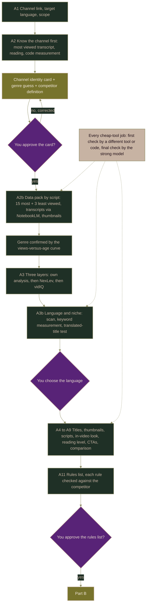
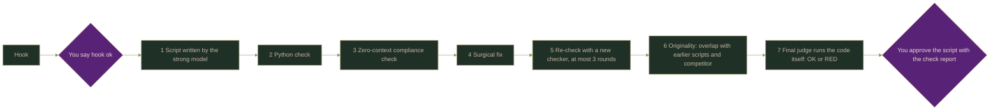

# YouTube Automation Competitor Analysis


> Build a faceless YouTube automation channel from the ground up. One end-to-end workflow takes you from a competitor's link to a channel setup, an audited master prompt and the script of your first video. A script collects the data, cheap tools do the heavy reading, and every cheap-tool job is checked by code or by an independent strong-model pass, with unchecked claims labeled as such.


**Contents:** [Why](#why-this-exists) · [What makes it different](#what-makes-it-different) · [How it works](#how-it-works) · [What you get](#what-you-get) · [Helper scripts](#helper-scripts) · [Reference](#reference) · [Requirements](#requirements) · [Install](#install) · [Example prompts](#example-prompts) · [Example conversation](#example-conversation) · [FAQ](#faq) · [Limitations](#limitations) · [Credits](#credits) · [License](#license)

## What's new in v1.3.0

- **Thumbnail analysis grows to 20 items (A5).** Gemini inspects the thumbnails in detail, a small Claude model spot-checks, and the analysis adds a hand test, a text test, a table of measurable fields, a chronological style-repetition analysis and a title-to-thumbnail-text mapping table that yields formulas for deriving thumbnail text from a title.
- **Producing your own thumbnails from the report (A5b).** Gemini designs at least 6 concepts, the strong model checks them, ChatGPT produces them in one conversation, and nothing is decided before the user has seen it and done the hand test.

## What's new in v1.2.0

- **Rules from the minute-by-minute analysis (A6d).** A mandatory step before the master is written: every finding is sorted into three boxes (already in the master and confirmed, disproved, a new mechanism), the user picks which rule candidates to keep, only the mechanism is taken (never the competitor's visuals or wording), and approved rules go into the master with tags.

## What's new in v1.1.0

- **Minute-by-minute video analysis (A6c).** Watch the competitor's most viewed video locally with Gemini CLI (no vidIQ needed): the video is downloaded at 480p, split into pieces of about 4:20, and each piece is turned into a table of time, narration, on-screen content and transition. A three-tier check (frame comparison, sound measured by code, a full read by the strong model) guards it, and the known limits are written down.

## Why this exists

Studying a competitor channel by hand means opening dozens of videos, copying titles into a sheet, guessing at thumbnails and writing a prompt from memory. Worse, if you scan before you understand the channel, you collect the wrong competitors (in a trial on a physics explainer channel, school and exam channels were counted as rivals because the channel was mistaken for a lesson channel). This skill fixes that order: it identifies the channel first, collects the data itself, measures what can be counted, and only then derives the questions for your master prompt.

| By hand | With this skill |
|---|---|
| Open videos one by one, copy titles and numbers | One script collects the 15 most viewed and 3 least viewed videos: titles, exact views, descriptions, chapters, thumbnails, verbatim transcripts (yt-dlp subtitles as a fallback; gaps are listed, never filled in) |
| Guess the channel's type from a few videos | A channel identity card with a genre guess (Evergreen, Cashcow, Trend, Hype), evidence, a confidence level and counter-evidence, approved by you before anything else runs |
| Trust a summary | Everything countable is counted by code; every cheap-tool job is checked by the strong model with a minimum sample and a written "Verification" section |
| Write a master prompt from memory | The master's questions are pulled out of the competitor's measured values, then the master is written and audited in up to 3 rounds by fresh, zero-context checkers |

## What makes it different

These are the author's own rules, found by running this analysis on real channels:

- **Know the channel first.** No language scan, competitor search or data pack starts before the identity card and your approval.
- **Adapt the mechanism, never copy the wording.** The skill separates what makes a competitor work (the mechanism) from its sentences, scenes and thumbnails (never taken), and states the risk of resembling one competitor too closely.
- **Outlier and VPH, not views.** Topics and competitor videos are ranked by Outlier score and views per hour; raw views never decide.
- **Two-tier checking saves tokens.** A different cheap tool (Gemini or ChatGPT) or code does the first check from raw data without seeing the claim; the strong model compares a short report instead of reading raw output.
- **The producer is never the checker.** A pass mark comes only from code output or an independent checker. One wrong sample makes the whole job unreliable.
- **Transcripts come from NotebookLM, not from paid credits.** A persistent notebook per competitor gives the verbatim text with no model in between.
- **The master is audited like a script.** The skill tells Claude to build a Python checker calibrated on the competitor's own videos, with a mandatory self-test (the checker is generated per channel, not shipped as a file), and the master goes through up to 3 rounds with a new zero-context checker each time.
- **Two methods for the video, never one.** The minute-by-minute watch is checked against real frames and a sound measurement by code. In the first run, one tool's "music and sound effects" claim was disproved by the measurement.
- **You keep the creative links.** Titles, thumbnails and hooks stay yours; the agent never rewrites them, and nothing enters the master without approval.

## How it works

The workflow has two parts. **Part A** analyzes the competitor, **part B** turns the analysis into an audited master prompt. Purple diamonds are approval gates: nothing moves on without your decision.

### Part A: analyze the competitor



### Part B: from analysis to an audited master prompt

```mermaid
%%{init: {"theme":"base","themeVariables":{"fontFamily":"Georgia, serif","primaryColor":"#1F3026","primaryTextColor":"#C7B3A3","primaryBorderColor":"#8F8E66","lineColor":"#8F8E66","tertiaryTextColor":"#C7B3A3","edgeLabelBackground":"#1F3026"}}}%%
flowchart TD
    B1["B1 Rules list and genre approved, language decided"] --> B1B["B1b Topics and competitor videos ranked by Outlier and VPH"]
    B1B --> B1C["B1c Main-concept keyword measurement"]
    B1C --> G4{"You approve the titles?"}
    G4 --> B2["B2 Question form filled from the competitor: measured value, suggestion, your decision"]
    B2 --> G5{"You fill in the form"}
    G5 --> B5["B5 Checker tools generated per channel + rule matrix + self-test"]
    B5 --> B3["B3 Master prompt written by the strong model"]
    B3 --> R["B6 Audit round: Python master check + fresh zero-context checker"]
    R --> FIX["Fix findings"]
    FIX --> R2{"CRITICAL findings left and fewer than 3 rounds?"}
    R2 -- "yes" --> R
    R2 -- "no" --> G6{"You approve the open points"}
    G6 --> M["Master prompt ready"]
    classDef cBase fill:#1F3026,stroke:#8F8E66,color:#C7B3A3,stroke-width:1.5px
    classDef cGate fill:#582377,stroke:#A3787B,color:#E6D9CC,stroke-width:1.5px
    classDef cOut fill:#77732C,stroke:#C7B3A3,color:#F2E8DD,stroke-width:1.5px
    class B1,B1B,B1C,B2,B5,B3,R,FIX cBase
    class G4,G5,R2,G6 cGate
    class M cOut
```



### Inside the master: the script quality loop

Every script written under the master goes through this loop (B3):



## What you get

| Step | Output |
|---|---|
| A2 Channel identity | `channel-identity.md`: one-sentence result, evidence, genre guess, competitor definition |
| A2b Data pack | titles, exact views, descriptions, chapters, thumbnails, verbatim transcripts, an UNAVAILABLE list |
| A3 to A9 Analysis | title formula and ratios, a 20-item thumbnail analysis and a step for producing your own thumbnails, script structure, reading level (CEFR plus measured ratios), CTA table, comparison with your channel |
| A3b Language and niche | a language-gap scan, keyword measurements (Monthly searches, competition color, Keyword Score) and a translated-title test |
| A10 Channel setup | 10 channel names checked for overlap, a keyword-based description, logo and banner prompts, a video timeline |
| B1b Topic scoring | topics and competitor videos ranked by Outlier and VPH |
| B2 to B8 Master prompt | a question form with measured competitor values, the master's structure, a CTA matrix, a rule-matrix template and a ready prompt for generating a per-channel Python checker with a self-test, an SEO section |

## Helper scripts

The skill ships five scripts in `scripts/`. Run them with `python -I -X utf8`.

| Script | What it does |
|---|---|
| `fetch_competitor_data.py` | Lists a channel's most viewed videos with yt-dlp, saves metadata, descriptions, chapters and thumbnails, measures thumbnails with Pillow, and gets verbatim transcripts from a persistent NotebookLM notebook (falls back to yt-dlp subtitles) |
| `measure_channel_identity.py` | Measures a transcript for the identity card: unique-word ratio, pronoun density, marker densities (lesson, story, analogy, curiosity, caveat), CTA positions in percent, a hook sample and a 10-slice rhythm |
| `measure_genre_curve.py` | Measures upload frequency, views per day by age, the newer-to-older ratio and the single-video share that hint at the channel's genre |
| `verify_punctuation_repair.py` | Proves by code that a punctuation repair of a NotebookLM transcript changed no word (the word sequences must be identical) |
| `measure_reading_level.py` | On the punctuated transcript: sentence-length ratios, average and longest sentence, unique-word ratio, repeated words and an approximate readability formula (Flesch for English, Wiener Sachtextformel for German) |

Example:

```bash
python -I -X utf8 scripts/fetch_competitor_data.py https://www.youtube.com/@channel data/channel --count 15 --least 3 --lang en --name "Channel"
```

## Reference

Two long-form files in `reference/` hold the working method behind the skill:

- [reference/method-and-rules.md](reference/method-and-rules.md): the philosophy, the standard questions, what to collect, the thumbnail detail list (the skill extends it to 20 items), the CTA rules, how to validate a master's rules against the competitor, the common mistakes and the reasons behind each rule.
- [reference/ready-made-prompts.md](reference/ready-made-prompts.md): the prompts the author really used, for running the steps by hand or in another assistant.

## Requirements

Everything below is checked on the first run; the skill asks before installing anything.

| Needed | For | How it is set up |
|---|---|---|
| Python 3, `yt-dlp`, Pillow | The data pack and measurements | `pip install yt-dlp pillow` |
| Node.js | yt-dlp's JavaScript runtime | Install from nodejs.org |
| NotebookLM CLI (`nlm`) | Verbatim transcripts in a persistent notebook per competitor | `uv tool install notebooklm-mcp-cli` (or `pipx install notebooklm-mcp-cli`), then `nlm login` |
| vidIQ MCP | Outlier, VPH, keyword research, channel search, video watching | Add the vidIQ MCP server to Claude Code and sign in. Without it, those steps ask you for vidIQ screenshots |
| NexLev MCP (optional) | A second source for outliers | Add the NexLev MCP server and sign in |
| Gemini CLI or Codex CLI (optional) | Cheap first checks and drafts; Gemini CLI also watches a local video file for the minute-by-minute analysis | Install and sign in. Without them, a small Claude model does those jobs |
| ffmpeg (when needed) | Splitting a local video and measuring sound for the minute-by-minute analysis; also fallback transcripts (with Whisper) | Installed only if needed, after asking |

## Install

```bash
git clone https://github.com/jenny-gecglr/youtube-automation-competitor-analysis.git ~/.claude/skills/youtube-automation-competitor-analysis
```

Or download the folder and place it at `~/.claude/skills/youtube-automation-competitor-analysis`.

## Example prompts

- "Analyze this competitor: https://www.youtube.com/@channel"
- "New channel analysis, then prepare a master prompt from it."
- "Which language has a gap for this channel's format?"
- "Score my topic list by Outlier and VPH against this competitor."

## Example conversation

```text
You:    Analyze this competitor: https://www.youtube.com/@channel
Claude: First the identity card, before any scan. I fetched the most viewed
        video's transcript with NotebookLM, read it, and measured it with code:
        the channel looks like a popular-science narrator, not a lesson
        channel, with a guess of mostly Cashcow. Confidence is medium, and the
        counter-evidence is that the channel is young. School and exam
        channels are excluded from the competitor definition. Is the channel
        this?
You:    Yes.
Claude: Collecting the 15 most viewed and 3 least viewed videos now. When the
        data pack is done I will measure the curve to confirm the genre, then
        move on to titles, thumbnails and scripts.
```

## FAQ

**Do I have to download anything by hand?** No. The skill builds the data pack itself; you provide the channel link and the decisions.

**Why does it check so much?** A cheap tool can be fast and wrong. Every cheap-tool job is sampled by the strong model, and one wrong sample marks the whole job unreliable.

**Does it copy the competitor?** No. It adapts mechanisms in your own sentences and never takes wording, scenes, titles or thumbnails, and it tells you about the risk of resembling one competitor too closely.

**Can I skip the master prompt?** Yes. Part A (the analysis) stands on its own; part B (the master prompt) starts when you approve the rules list.

## Limitations

- The language scan is a rough first elimination, not decision evidence; the translated-title test decides.
- NotebookLM's verbatim transcripts have no punctuation. The skill repairs the punctuation automatically (a cheap tool adds only punctuation, `verify_punctuation_repair.py` proves no word changed) before it measures sentence lengths, and the readability formulas use estimated syllables, so they are approximate.
- CTR, average view duration and first-30-second retention cannot be seen on a competitor channel, only on your own.
- Outlier, VPH, keyword and language-scan steps need a vidIQ account; some video-watching features need a paid plan.
- The marker lists in `measure_channel_identity.py` are English; edit them for other languages.
- The minute-by-minute analysis is approximate: at 1 frame per second a hard cut cannot be told from a fade, and cut counts and dB figures are rough, and transitions on a piece boundary are counted twice. It covers one video.
- Genre counts are rough markers, not verdicts.
- It is a method for Claude Code, not a hosted service, and tool names such as vidIQ and NexLev may change.

## Credits

The visual identity of this repository (its color palette and art direction) is the author's own. The banner illustration was generated with Google Flow (Nano Banana) from original prompts, and the lettering was added afterwards. The title is set in Cinzel Decorative, the script line in Pinyon Script and the subtitle in Cormorant Garamond, all under the SIL Open Font License.

## License

MIT. See [LICENSE](LICENSE).
