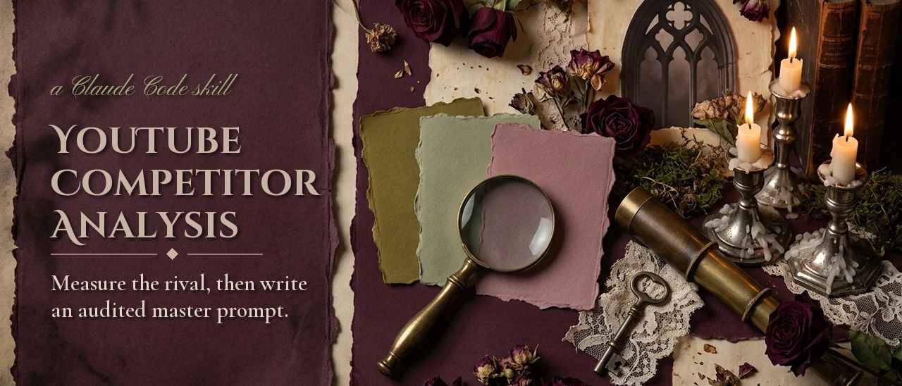
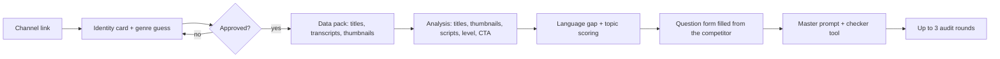

# YouTube Competitor Analysis



> Analyze a YouTube competitor without collecting anything by hand, then turn what you learn into an audited master prompt. The data pack is built by script, the cheap tools do the heavy reading, and every cheap-tool job is checked by code or by an independent strong-model pass, with unchecked claims labeled as such.


**Contents:** [Why](#why-this-exists) · [What makes it different](#what-makes-it-different) · [How it works](#how-it-works) · [What you get](#what-you-get) · [Helper scripts](#helper-scripts) · [Reference](#reference) · [Requirements](#requirements) · [Install](#install) · [Example prompts](#example-prompts) · [Example conversation](#example-conversation) · [FAQ](#faq) · [Limitations](#limitations) · [Credits](#credits) · [License](#license)

## Why this exists

Studying a competitor channel by hand means opening dozens of videos, copying titles into a sheet, guessing at thumbnails and writing a prompt from memory. Worse, if you scan before you understand the channel, you collect the wrong competitors (in a trial on a physics explainer channel, school and exam channels were counted as rivals because the channel was mistaken for a lesson channel). This skill fixes that order: it identifies the channel first, collects the data itself, measures what can be counted, and only then derives the questions for your master prompt.

| By hand | With this skill |
|---|---|
| Open videos one by one, copy titles and numbers | One script collects the 15 most viewed and 3 least viewed videos: titles, exact views, descriptions, chapters, thumbnails, verbatim transcripts (yt-dlp subtitles as a fallback; gaps are listed, never filled in) |
| Guess the channel's type from a few videos | A channel identity card with a genre guess (Evergreen, Cashcow, Trend, Hype), evidence, a confidence level and counter-evidence, approved by you before anything else runs |
| Trust a summary | Everything countable is counted by code; every cheap-tool job is checked by the strong model with a minimum sample and a written "Verification" section |
| Write a master prompt from memory | The master's questions are pulled out of the competitor's measured values, then the master is written and audited in up to 3 rounds by fresh, zero-context checkers |

## What makes it different

These are the author's own rules, found by running this analysis on real channels:

- **Know the channel first.** No language scan, competitor search or data pack starts before the identity card and your approval.
- **Adapt the mechanism, never copy the wording.** The skill separates what makes a competitor work (the mechanism) from its sentences, scenes and thumbnails (never taken), and states the risk of resembling one competitor too closely.
- **Outlier and VPH, not views.** Topics and competitor videos are ranked by Outlier score and views per hour; raw views never decide.
- **Two-tier checking saves tokens.** A different cheap tool (Gemini or ChatGPT) or code does the first check from raw data without seeing the claim; the strong model compares a short report instead of reading raw output.
- **The producer is never the checker.** A pass mark comes only from code output or an independent checker. One wrong sample makes the whole job unreliable.
- **Transcripts come from NotebookLM, not from paid credits.** A persistent notebook per competitor gives the verbatim text with no model in between.
- **The master is audited like a script.** The skill tells Claude to build a Python checker calibrated on the competitor's own videos, with a mandatory self-test (the checker is generated per channel, not shipped as a file), and the master goes through up to 3 rounds with a new zero-context checker each time.
- **You keep the creative links.** Titles, thumbnails and hooks stay yours; the agent never rewrites them, and nothing enters the master without approval.

## How it works



## What you get

| Step | Output |
|---|---|
| A2 Channel identity | `channel-identity.md`: one-sentence result, evidence, genre guess, competitor definition |
| A2b Data pack | titles, exact views, descriptions, chapters, thumbnails, verbatim transcripts, an UNAVAILABLE list |
| A3 to A9 Analysis | title formula and ratios, a 15-point thumbnail analysis, script structure, reading level (CEFR plus measured ratios), CTA table, comparison with your channel |
| A3b Language and niche | a language-gap scan, keyword measurements (Monthly searches, competition color, Keyword Score) and a translated-title test |
| A10 Channel setup | 10 channel names checked for overlap, a keyword-based description, logo and banner prompts, a video timeline |
| B1b Topic scoring | topics and competitor videos ranked by Outlier and VPH |
| B2 to B8 Master prompt | a question form with measured competitor values, the master's structure, a CTA matrix, a rule-matrix template and a ready prompt for generating a per-channel Python checker with a self-test, an SEO section |

## Helper scripts

The skill ships three scripts in `scripts/`. Run them with `python -I -X utf8`.

| Script | What it does |
|---|---|
| `fetch_competitor_data.py` | Lists a channel's most viewed videos with yt-dlp, saves metadata, descriptions, chapters and thumbnails, measures thumbnails with Pillow, and gets verbatim transcripts from a persistent NotebookLM notebook (falls back to yt-dlp subtitles) |
| `measure_channel_identity.py` | Measures a transcript for the identity card: unique-word ratio, pronoun density, marker densities (lesson, story, analogy, curiosity, caveat), CTA positions in percent, a hook sample and a 10-slice rhythm |
| `measure_genre_curve.py` | Measures upload frequency, views per day by age, the newer-to-older ratio and the single-video share that hint at the channel's genre |

Example:

```bash
python -I -X utf8 scripts/fetch_competitor_data.py https://www.youtube.com/@channel data/channel --count 15 --least 3 --lang en --name "Channel"
```

## Reference

Two long-form files in `reference/` hold the working method behind the skill:

- [reference/method-and-rules.md](reference/method-and-rules.md): the philosophy, the standard questions, what to collect, the full 15-point thumbnail list, the CTA rules, how to validate a master's rules against the competitor, the common mistakes and the reasons behind each rule.
- [reference/ready-made-prompts.md](reference/ready-made-prompts.md): the prompts the author really used, for running the steps by hand or in another assistant.

## Requirements

Everything below is checked on the first run; the skill asks before installing anything.

| Needed | For | How it is set up |
|---|---|---|
| Python 3, `yt-dlp`, Pillow | The data pack and measurements | `pip install yt-dlp pillow` |
| Node.js | yt-dlp's JavaScript runtime | Install from nodejs.org |
| NotebookLM CLI (`nlm`) | Verbatim transcripts in a persistent notebook per competitor | `uv tool install notebooklm-mcp-cli` (or `pipx install notebooklm-mcp-cli`), then `nlm login` |
| vidIQ MCP | Outlier, VPH, keyword research, channel search, video watching | Add the vidIQ MCP server to Claude Code and sign in. Without it, those steps ask you for vidIQ screenshots |
| NexLev MCP (optional) | A second source for outliers | Add the NexLev MCP server and sign in |
| Gemini CLI or Codex CLI (optional) | Cheap first checks and drafts | Install and sign in. Without them, a small Claude model does those jobs |
| Whisper and ffmpeg (fallback only) | Transcripts that NotebookLM cannot get | Installed only if needed, after asking |

## Install

```bash
git clone https://github.com/jenny-gecglr/youtube-competitor-analysis.git ~/.claude/skills/youtube-competitor-analysis
```

Or download the folder and place it at `~/.claude/skills/youtube-competitor-analysis`.

## Example prompts

- "Analyze this competitor: https://www.youtube.com/@channel"
- "New channel analysis, then prepare a master prompt from it."
- "Which language has a gap for this channel's format?"
- "Score my topic list by Outlier and VPH against this competitor."

## Example conversation

```text
You:    Analyze this competitor: https://www.youtube.com/@channel
Claude: First the identity card, before any scan. I fetched the most viewed
        video's transcript with NotebookLM, read it, and measured it with code:
        the channel looks like a popular-science narrator, not a lesson
        channel, with a guess of mostly Cashcow. Confidence is medium, and the
        counter-evidence is that the channel is young. School and exam
        channels are excluded from the competitor definition. Is the channel
        this?
You:    Yes.
Claude: Collecting the 15 most viewed and 3 least viewed videos now. When the
        data pack is done I will measure the curve to confirm the genre, then
        move on to titles, thumbnails and scripts.
```

## FAQ

**Do I have to download anything by hand?** No. The skill builds the data pack itself; you provide the channel link and the decisions.

**Why does it check so much?** A cheap tool can be fast and wrong. Every cheap-tool job is sampled by the strong model, and one wrong sample marks the whole job unreliable.

**Does it copy the competitor?** No. It adapts mechanisms in your own sentences and never takes wording, scenes, titles or thumbnails, and it tells you about the risk of resembling one competitor too closely.

**Can I skip the master prompt?** Yes. Part A (the analysis) stands on its own; part B (the master prompt) starts when you approve the rules list.

## Limitations

- The language scan is a rough first elimination, not decision evidence; the translated-title test decides.
- NotebookLM's verbatim transcripts have no punctuation, so sentence-length ratios need a punctuation repair first.
- CTR, average view duration and first-30-second retention cannot be seen on a competitor channel, only on your own.
- Outlier, VPH, keyword and language-scan steps need a vidIQ account; some video-watching features need a paid plan.
- The marker lists in `measure_channel_identity.py` are English; edit them for other languages.
- Genre counts are rough markers, not verdicts.
- It is a method for Claude Code, not a hosted service, and tool names such as vidIQ and NexLev may change.

## Credits

The visual identity of this repository (its color palette and art direction) is the author's own. The banner illustration was generated with Google Flow (Nano Banana) from original prompts, and the lettering was added afterwards. The title is set in Cinzel Decorative, the script line in Pinyon Script and the subtitle in Cormorant Garamond, all under the SIL Open Font License.

## License

MIT. See [LICENSE](LICENSE).
